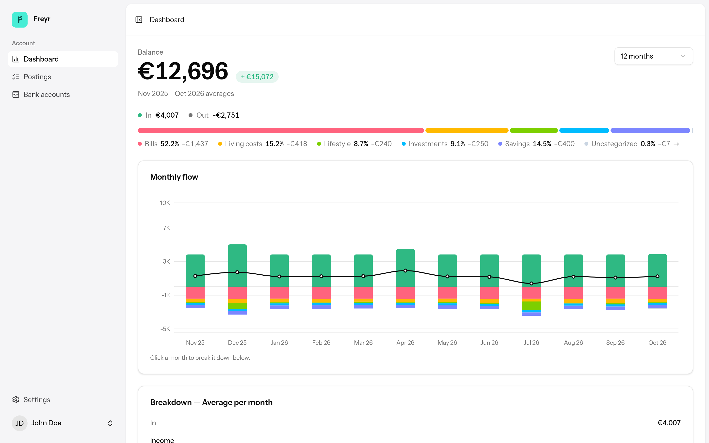
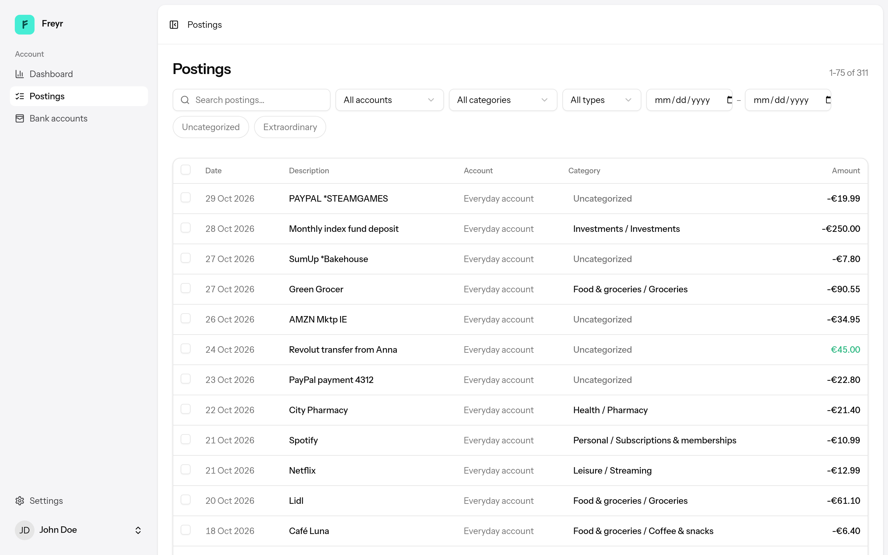
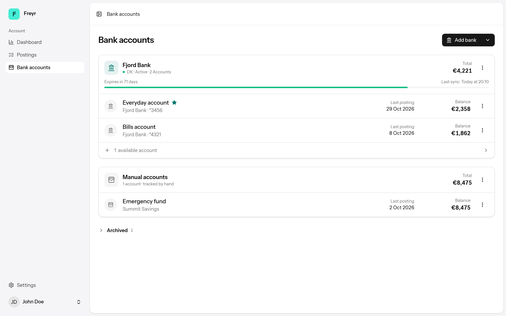
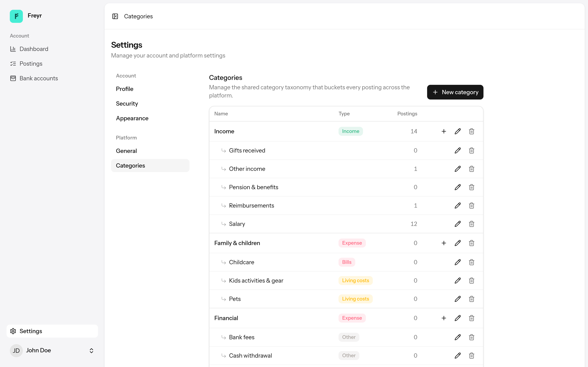
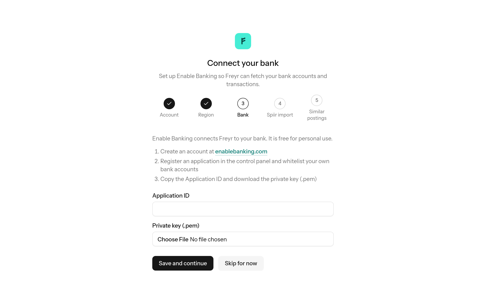

<picture>
  <source media="(prefers-color-scheme: dark)" srcset="art/banner-dark.svg">
  
</picture>

Freyr is a self-hosted budgeting app. It connects to your bank, imports your
transactions every few hours, and shows you where your money goes. Your data
stays on your own server.

It is built in the spirit of [Spiir](https://spiir.dk), the Danish budgeting
app that has been discontinued, and it can import a Spiir data export.

> **Freyr is in beta.** It is used day to day, but expect rough edges and the
> occasional breaking change. Feedback and contributions are very welcome.

<picture>
  <source media="(prefers-color-scheme: dark)" srcset="art/screenshots/dashboard-dark.png">
  
</picture>

## Features

- **Bank connections** through [Enable Banking](https://enablebanking.com), a
  licensed PSD2 open banking provider that is free for personal use.
- **Automatic imports** every three hours, with deduplication and a log of
  what each sync did.
- **Dashboard** with your balance, monthly income and expenses, and a
  breakdown by category for any month.
- **Categories** you can shape yourself, starting from a sensible default
  tree, with quick inline and bulk categorization.
- **Similar postings** (optional, uses your OpenAI key) suggests categories
  from postings you have already sorted, and can apply them automatically.
- **Manual accounts** for cash, loans, or banks that are not connected.
- **Multiple currencies**, converted to your reporting currency with European
  Central Bank rates.
- **AI assistants** can read and categorize your postings through the built-in
  [MCP](https://modelcontextprotocol.io) server.
- **Spiir import** brings over your accounts, categories, and history.
- **REST API**, passkeys, two-factor authentication, and dark mode.

| Postings                                                    | Bank accounts                                                        |
| ----------------------------------------------------------- | -------------------------------------------------------------------- |
|  |   |
| **Categories**                                              | **Setup wizard**                                                     |
|       |  |

## Installation

Freyr is a [Laravel](https://laravel.com) app. You need:

- PHP 8.5 and [Composer](https://getcomposer.org)
- Node.js and [pnpm](https://pnpm.io)
- PostgreSQL with the [`pgvector`](https://github.com/pgvector/pgvector) extension
- Redis, for the background queue

Install the app:

```bash
git clone https://github.com/rasmuscnielsen/freyr.git
cd freyr

composer install --no-dev
pnpm install --frozen-lockfile && pnpm run build

cp .env.example .env
php artisan key:generate
```

Set your database connection (`DB_*`) and `APP_URL` in `.env`, then run:

```bash
php artisan app:install
```

This runs the migrations, seeds the default categories, and creates the keys
used for API tokens and MCP logins. It asks you to confirm, because Freyr
runs in production mode; in a script, pass `--force` instead.

> [!IMPORTANT]
> Keep `APP_ENV=production` and `APP_DEBUG=false` from `.env.example` on any
> server. Local mode opens the Horizon dashboard to everyone and enables a
> passwordless login shortcut, and debug mode shows error details, including
> database queries, to anyone.

Now open Freyr in your browser. A setup wizard creates your administrator
account, then asks for your country and reporting currency. After that it
helps you connect Enable Banking, import from Spiir, and turn on similar
postings. You can skip those three and set them up later under **Settings →
Platform**.

### Try it with demo data

To look around on your own machine without connecting a bank, load a demo
account with a year of sample data. The demo needs the development packages
and local mode: run `composer install` without `--no-dev`, set
`APP_ENV=local` in `.env`, then run:

```bash
php artisan app:install --demo
```

Then log in as `john@example.com` with the password `password`.

> [!WARNING]
> `--demo` wipes the database first. Never run it on an install with real data.

### Running in production

Freyr needs a queue worker and the scheduler next to the web server. Set
`QUEUE_CONNECTION=redis` in `.env`, then:

- keep `php artisan horizon` running, for example with Supervisor, and
- add a cron entry that runs `php artisan schedule:run` every minute.

The scheduler syncs your banks every three hours. You can also sync from the
app at any time.

To update Freyr, pull the latest code and run:

```bash
git pull
composer install --no-dev
pnpm install --frozen-lockfile && pnpm run build
php artisan app:deployed
```

`app:deployed` runs new migrations, rebuilds the caches, and restarts Horizon.

The Horizon dashboard is at `/horizon` and is only open to platform
administrators.

Back up your database, your `.env` file, and the `storage` directory, which
holds the API token keys. The `APP_KEY` in `.env` encrypts the Enable Banking
and OpenAI credentials stored in the database; without it, Freyr cannot read
them.

## Connecting your bank

Enable Banking is free for personal use: you register an application and
whitelist your own bank accounts.

1. Create an account at [enablebanking.com](https://enablebanking.com) and
   register an application.
2. Copy the **Application ID** and download the **private key** (`.pem`).
3. Enter both in the setup wizard, or later under **Settings → Platform →
   General**. They are stored encrypted.

Then go to **Bank accounts → Add bank**, pick your bank, and log in with it.
Bank authorizations expire after 90 days; Freyr shows when to renew.

## Moving from Spiir

The setup wizard can import a Spiir data export. Upload `Categories.json`,
`User.csv`, `Account.csv`, and `Posting.csv`. The import is also available
later under **Settings → Platform → General** while Freyr has no postings yet.

Your Spiir categories replace the default ones. When you then connect your
bank and link it to an imported account, Freyr only fetches transactions newer
than the imported history, so nothing is duplicated.

## AI assistants (MCP)

Freyr has a built-in [MCP](https://modelcontextprotocol.io) server, so an AI
assistant such as Claude or ChatGPT can look at your postings and help you
categorize them. Try asking it to "categorize my uncategorized postings from
last month".

Add `https://your-freyr-host/mcp` as a custom connector in your assistant.
Clients that support OAuth register themselves and ask you to approve access
in Freyr. Other clients can send a personal access token from **Settings →
Security** as a bearer token.

For an agent on the same machine, start the server over stdio instead:

```bash
php artisan mcp:start freyr
```

The assistant can list, search, and categorize postings, look up categories
and accounts, find similar postings, and manage postings in manual accounts.
Changes it makes are marked as coming from MCP.

## REST API

Freyr has a read-only JSON API. Create a personal access token under
**Settings → Security** and send it as a bearer token:

```bash
curl https://your-freyr-host/api/postings \
  -H "Authorization: Bearer <your-token>" \
  -H "Accept: application/json"
```

| Endpoint                               | Description                        |
| -------------------------------------- | ---------------------------------- |
| `GET /api/bank-accounts`               | Your bank accounts                 |
| `GET /api/bank-accounts/{id}`          | One bank account                   |
| `GET /api/bank-accounts/{id}/postings` | Postings in one account            |
| `GET /api/postings`                    | Your postings                      |
| `GET /api/postings/{id}`               | One posting                        |
| `GET /api/categories`                  | Categories and their subcategories |
| `GET /api/categories/{id}`             | One category                       |
| `GET /api/reports/overview`            | Income and expenses for a period   |
| `GET /api/reports/overview/categories` | The same, broken down by category  |

## Configuration reference

Most settings live in the app. If you prefer to configure Freyr through the
environment, for example in a container, these variables are used whenever
the setting has not been saved in the app:

| Variable                       | Description                                                   | Default                         |
| ------------------------------ | ------------------------------------------------------------- | ------------------------------- |
| `ENABLE_BANKING_APP_ID`        | Enable Banking application ID                                 | —                               |
| `ENABLE_BANKING_PRIVATE_KEY`   | Path to the application's private key                         | `storage/{APP_ID}.pem`          |
| `ENABLE_BANKING_BASE_URL`      | Enable Banking API URL                                        | `https://api.enablebanking.com` |
| `ENABLE_BANKING_ACCESS_DAYS`   | Days a bank authorization stays valid                         | `90`                            |
| `ENABLE_BANKING_ASPSP_COUNTRY` | Bank country used when none is chosen                         | `DK`                            |
| `ENABLE_BANKING_PSU_TYPE`      | Account holder type (`personal` or `business`)                | `personal`                      |
| `ENABLE_BANKING_LANGUAGE`      | Language of the bank's login flow                             | `en`                            |
| `OPENAI_API_KEY`               | OpenAI key for similar postings                               | —                               |
| `TRUSTED_PROXIES`              | Comma-separated proxy IPs or CIDR ranges, when behind a proxy | —                               |

Freyr only sends email for password resets. Configure the standard Laravel
`MAIL_*` variables if you want them; otherwise mail is written to the log.

## Contributing

For development, install with `composer install` (including the development
packages) and set `APP_ENV=local` and `APP_DEBUG=true` in `.env`.
`composer run dev` starts the web server, queue worker, log viewer, and Vite
together. Run the tests with `php artisan test --compact`. See
[CONTRIBUTING.md](CONTRIBUTING.md) for the rest.

Freyr is built with Laravel 13, Inertia.js, React 19, Tailwind CSS 4,
PostgreSQL, Redis, Horizon, Passport, Fortify, and Laravel MCP.

## License

Freyr is open-source software licensed under the [MIT license](LICENSE).
