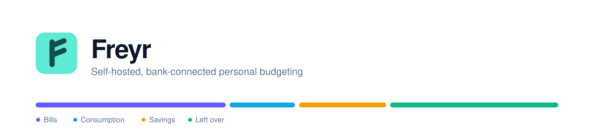

<picture>
  <source media="(prefers-color-scheme: dark)" srcset="art/banner-dark.svg">
  
</picture>

# Freyr

Freyr is a self-hosted personal budgeting application. It connects to your bank,
imports your transactions automatically, and gives you a clear overview of where
your money goes.

It is an open-source project built in the spirit of [Spiir](https://spiir.dk) —
the popular Danish budgeting app that has been discontinued — for people who want
to keep an automatic, bank-connected budgeting overview while owning their own
data on their own server.

> **Status: MVP.** Freyr is functional but early. Expect rough edges, breaking
> changes, and missing polish. Contributions and feedback are welcome.

## Features

- **Bank connections** via [Enable Banking](https://enablebanking.com) (PSD2 open
  banking), so you can link real bank accounts through a licensed aggregator.
- **Automatic transaction import** with deduplication, so re-syncing the same
  period does not create duplicate postings.
- **Sync audit trail** — every sync run is recorded (new / updated / duplicate
  posting counts, time range, timing) so you can see exactly what each sync did.
- **Manual categorization** with a full category tree (categories and
  subcategories, income / expense / saving / transfer types).
- **Dashboard** with an income and expense overview.
- **Read-only REST API** protected by Laravel Passport personal access tokens.
- **MCP server** (`/mcp`) that lets AI agents (Claude, ChatGPT, etc.) query and manage your budgeting data — e.g. categorizing transactions.
- **Horizon queue dashboard** for monitoring background jobs.
- **Dark mode** (follows your system preference, with a manual toggle).

## Requirements

- **PHP 8.5**
- **PostgreSQL** (recommended). The app runs on other drivers, but the postings
  table stores an optional AI description embedding using the `pgvector`
  extension on PostgreSQL (it falls back to a plain JSON column on other
  drivers), and uses a `jsonb` column for posting metadata. PostgreSQL is the
  tested and recommended database.
- **Node.js + [pnpm](https://pnpm.io)** for the frontend build.
- **Redis** — required for [Laravel Horizon](https://laravel.com/docs/horizon),
  which drives the background queue.
- A [Composer](https://getcomposer.org) installation.

## Getting started

```bash
# 1. Install dependencies
composer install
pnpm install

# 2. Create your environment file
cp .env.example .env

# 3. Generate the application key
php artisan key:generate

# 4. Configure your database in .env (see .env.example), then install:
#    runs migrations, seeds the default category tree, and creates
#    the OAuth keys and personal access client used by API tokens
#    and MCP OAuth logins.
php artisan app:install

# 5. Build the frontend assets
pnpm run build

# 6. Open the app in your browser and follow the setup wizard —
#    it creates the first (administrator) account and walks you
#    through registration, Enable Banking and Spiir import.
```

In a local environment you can add `--demo` to reset the database and load a
demo user with sample data (see "Demo data" below):

```bash
php artisan app:install --demo
```

For local development you can run the full stack (PHP server, queue worker, log
tailer, and Vite dev server) with a single command:

```bash
composer run dev
```

## Enable Banking configuration

Freyr uses [Enable Banking](https://enablebanking.com) to connect to banks. You
need an Enable Banking account and an application registered in their control
panel.

Enable Banking is **completely free for personal use**: you can register a
production application and whitelist your own bank accounts for personal use,
so a self-hosted Freyr costs you nothing in API fees.

1. Sign up at [enablebanking.com](https://enablebanking.com) and create an
   application in their control panel.
2. Note your **Application ID** and download the **private key** (`.pem`) that
   Enable Banking issues for the application.
3. Enter the credentials in the setup wizard or later under **Platform →
   Settings** (stored encrypted in the database) — or configure the following
   environment variables as a fallback (see `config/services.php` under
   `enable_banking`):

   | Variable                          | Description                                                                                   | Default                          |
   | --------------------------------- | --------------------------------------------------------------------------------------------- | -------------------------------- |
   | `ENABLE_BANKING_APP_ID`           | Your Enable Banking application ID.                                                           | —                                |
   | `ENABLE_BANKING_PRIVATE_KEY`      | Path to the private key `.pem` file. Defaults to `storage/{APP_ID}.pem` if left unset.        | `storage_path("{APP_ID}.pem")`   |
   | `ENABLE_BANKING_BASE_URL`         | Enable Banking API base URL.                                                                  | `https://api.enablebanking.com`  |
   | `ENABLE_BANKING_ACCESS_DAYS`      | How many days a bank authorization stays valid before it must be renewed.                     | `90`                             |
   | `ENABLE_BANKING_TRANSACTION_DAYS` | How far back (in days) to fetch transactions on a sync.                                        | `30`                             |
   | `ENABLE_BANKING_ASPSP_COUNTRY`    | Default bank country code.                                                                    | `DK`                             |
   | `ENABLE_BANKING_PSU_TYPE`         | Payment service user type.                                                                    | `personal`                       |
   | `ENABLE_BANKING_LANGUAGE`         | Language for the bank authorization flow.                                                     | `en`                             |

Once configured, connect a bank from the **Bank connections** page in the app.
The account balances and transactions are then imported by Freyr.

## Background workers

Freyr uses a queue (via Horizon) and a scheduler.

Run the queue worker with Horizon:

```bash
php artisan horizon
```

The Horizon dashboard is available at `/horizon`. Access is restricted to
platform administrators (the first user, created by the setup wizard).

Run the scheduler:

```bash
php artisan schedule:work
```

**Bank syncs run via the scheduler.** The `app:bank-connections:sync`
command is scheduled to run daily (see `routes/console.php`), which is what keeps
your linked accounts up to date. You can also trigger a sync manually from the
app, and run the command directly:

```bash
php artisan app:bank-connections:sync
```

In production, make sure both a Horizon process and the scheduler are running
(e.g. a `cron` entry running `php artisan schedule:run` every minute, plus a
supervised `php artisan horizon` process).

After each deploy, run:

```bash
php artisan app:deployed
```

This runs pending migrations and, in production, rebuilds the framework caches
(`optimize`) and gracefully restarts the Horizon workers so they pick up the
new code.

## Registration

Registration is **disabled by default** — new installations are private. You
can allow other people to sign up in the setup wizard, or later under
**Platform → Settings**. When registration is disabled, the sign-up page
returns 404.

## Categories

Installing (`php artisan app:install`) seeds a sensible default tree of
categories and subcategories (income, housing, food, transport, savings, and
so on). It is safe to run in any environment and idempotent — re-running never
duplicates. A Spiir import replaces the defaults with your own tree. Editing
categories currently requires the database or a Spiir import; a management UI
is on the roadmap.

## Demo data

In a **local** environment you can reset the database and load a demo user
(`john@example.com`, password `password`) with sample accounts, a bank
connection, roughly a year of postings, and sync-run history:

```bash
php artisan app:install --demo
```

> **Warning:** `--demo` wipes the database first (`migrate:fresh`). In
> production, `app:install` asks for confirmation unless `--force` is given.

## Currencies

Amounts are stored and displayed in each account's own currency, and number
formatting follows your browser locale. The dashboard aggregates income and
expenses across accounts and displays totals in your most common account
currency — converting between currencies is not supported yet, so the dashboard
works best when your accounts share one currency.

## Migrating from Spiir

Freyr is built in the spirit of Spiir, and migrating from a Spiir data export
is a first-class flow. The recommended order:

1. **Install Freyr** (`php artisan app:install`, see "Getting started").
2. **Import your export.** On a fresh install, the setup wizard lets you
   upload the four export files (`Categories.json`, `User.csv`, `Account.csv`,
   `Posting.csv`) straight from your browser — it is also available later
   under **Platform → Settings** while no postings exist.

   The importer creates your user, accounts, categories, and postings from the
   export. Your Spiir category tree **replaces** the seeded default categories
   (the upload form warns before doing this).
3. **Connect your bank** from the Bank connections page and link each remote
   account to the matching imported account. When you link an account that
   already has imported history, Freyr only syncs transactions **newer** than
   your latest imported posting (via the account's `ignore_postings_before`
   date), so the first sync does not duplicate postings that came from the
   export.

## API

Freyr exposes a **read-only** REST API secured by Laravel Passport personal
access tokens.

**Create a token:** in the app, go to **Settings → Security** and create a
personal access token. The token is shown once; copy it immediately. Tokens
are granted `read`, `write`, and `mcp:use` scopes — the API endpoints only
honor `read`.

**Authenticate** by sending the token as a Bearer token:

```bash
curl https://your-freyr-host/api/postings \
  -H "Authorization: Bearer <your-token>" \
  -H "Accept: application/json"
```

**Endpoints** (all require authentication):

| Method | Endpoint                  | Description                              |
| ------ | ------------------------- | ---------------------------------------- |
| `GET`  | `/api/bank-accounts`      | List your bank accounts.                 |
| `GET`  | `/api/bank-accounts/{id}` | Show a single bank account.              |
| `GET`  | `/api/postings`           | List your postings (transactions).       |
| `GET`  | `/api/postings/{id}`      | Show a single posting.                   |
| `GET`  | `/api/categories`         | List categories and their subcategories. |
| `GET`  | `/api/categories/{id}`    | Show a single category.                  |

## MCP server

Freyr ships an [MCP](https://modelcontextprotocol.io) server so AI agents can
query and help manage your budgeting data — the flagship use case is letting
an agent review and categorize your transactions.

**HTTP transport** lives at `POST /mcp` behind OAuth bearer tokens
(`auth:api`). Two ways to authenticate:

- **OAuth** — MCP clients that support OAuth discovery (e.g. Claude) can
  register themselves via Dynamic Client Registration (`POST /oauth/register`)
  and complete an authorization-code + PKCE consent flow in your browser.
  Consent grants the `mcp:use` scope, which unlocks the full tool surface.
- **Personal access token** — a token from Settings → Security works as a
  bearer token too; its `read`/`write` scopes gate which tools register.

**Stdio transport** (same-machine agents, no auth — acts as your instance's
sole user):

```bash
php artisan mcp:start freyr
```

To limit context bloat, only `list-postings` is advertised in `tools/list`;
the remaining tools (`get-posting`, `list-categories`, `list-bank-accounts`,
`categorize-postings`, `edit-posting`) are discoverable via the built-in
`search_tools` and invoked via `execute_tools`.

**Categorization workflow for agents:** list uncategorized postings
(`list-postings` with `uncategorized`), load the taxonomy (`list-categories`,
including each subcategory's `hints`), then confirm categories in bulk with
`categorize-postings`. Writes mark `categorized_by: 'mcp'` as provenance.

## Tech stack

Laravel 13 · Inertia.js v3 · React 19 · Tailwind CSS v4 · PostgreSQL · Redis ·
Laravel Horizon · Laravel Passport · Laravel MCP · Laravel Fortify · Enable Banking.

## License

Freyr is open-source software licensed under the [MIT license](LICENSE).
